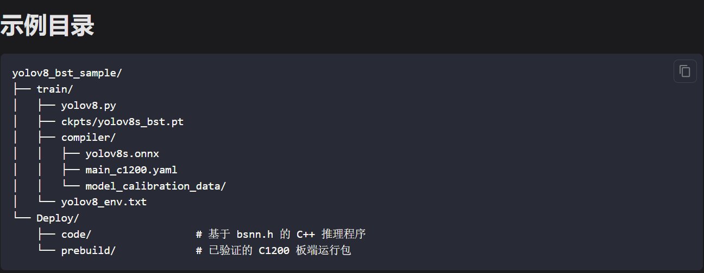
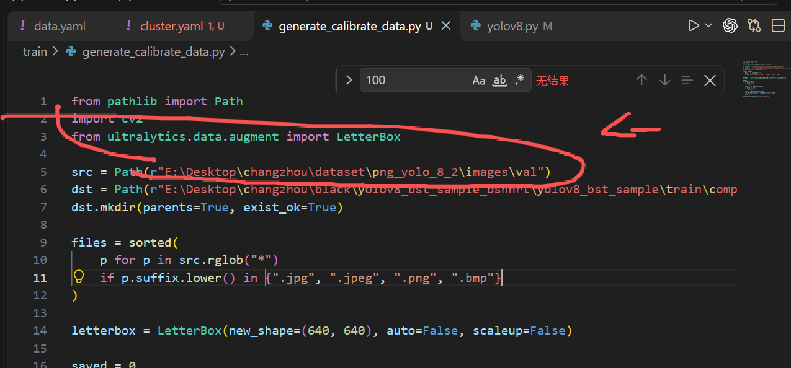
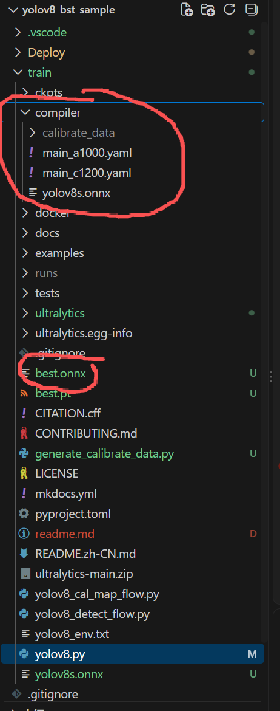
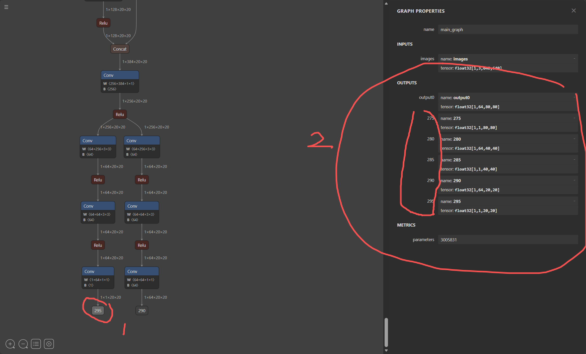
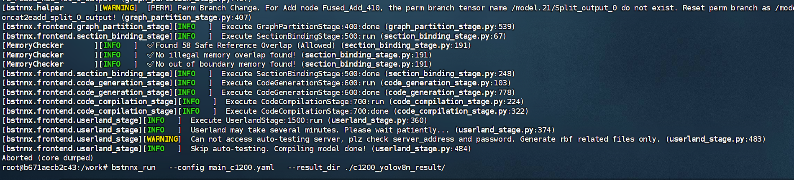
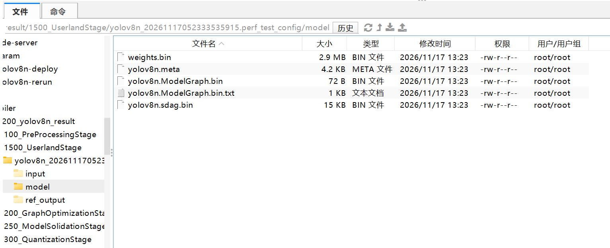

# 模型pt-onnx项目（[yolov8_bst_sample](https://pkgs.bstai.top/robot/sesamex-img-sdk/bstnnx/kalos_aura/yolov8_bst_sample_bsnnrt.zip)）下载，

## 项目示例目录：



## 导出onnx：

如果直接使用 `train/compiler/yolov8s.onnx`，可以跳过本节。自行训练和导出时执行：

```bash
cd yolov8_bst_sample/train
python yolov8.py --export \
  --model_path ./ckpts/yolov8s_bst.pt \
  --model_config yolov8s.yaml
```

针对个人项目pt，可以执行：

```bash
python -c "from ultralytics import YOLO; YOLO(r'.\ckpts\your_model.pt').export(format='onnx', imgsz=640, batch=1, dynamic=False, opset=12, simplify=True)"
```

官方例程是opset17 但是官方建议是12.所以本次采用12，输出是单个。

## 生成量化校准数据

执行：

```bash
python .\generate_calibrate_data.py
```



如果自定义数据集需要改上图地址。

---

## Docker 环境搭建与模型转换

将 `train/compiler` 目录拷贝到虚拟机。自己转换的 `onnx` 也放入文件夹，替换官方示例模型。


### 1. 安装 8.3.1 Docker 镜像

参考：[官方教程](https://documents.blacksesame.com/sesameX/bstnnx/02_%E7%8E%AF%E5%A2%83%E6%90%AD%E5%BB%BA)

参考命令：

```bash
wget -c --timeout=15 --tries=3 https://pkgs.bstai.top/robot/sesamex-img-sdk/bstnnx/kalos_aura/bsnn_tools_docker_8.3.1.tar.gz -O ~/bsnn_tools_docker_8.3.1.tar.gz
docker load -i ./bsnn_tools_docker_8.3.1.tar.gz
```

虚拟机进入 `compiler` 目录下，首先需要配置 `main_c1200.yaml`，主要涉及模型地址、量化图片地址以及 ONNX 格式问题。

在 `main_c1200.yaml` 有：

```yaml
output_order:
  'output0': DWH
  '275': DWH
  '280': DWH
  '285': DWH
  '290': DWH
  '295': DWH
```

这个配置根据 ONNX 决定。登录 [Netron](https://netron.app/)，选择之前导出的 ONNX，查看输出节点。`main_c1200.yaml` 默认的是官方配置，需要改成自己的模型配置。



接下来执行 Docker 命令：

```bash
docker run --rm -it --ipc=host -v "$PWD:/work" -w /work bsnn_tools:8.3.1 bash
```

然后执行转换命令：

```bash
bstnnx_run --config main_c1200.yaml --result_dir ./c1200_yolov8n_result/
```



注意虚拟机存储空间变化。如果转换卡死，存储空间变大可能有问题。

转换成功（大概 5~10 分钟）：



会在 `/home/kickpi/compiler/c1200_yolov8n_result/1500_UserlandStage/yolov8n_20261117052333535915.perf_test_config/model` 生成相关板端部署文件模型：


